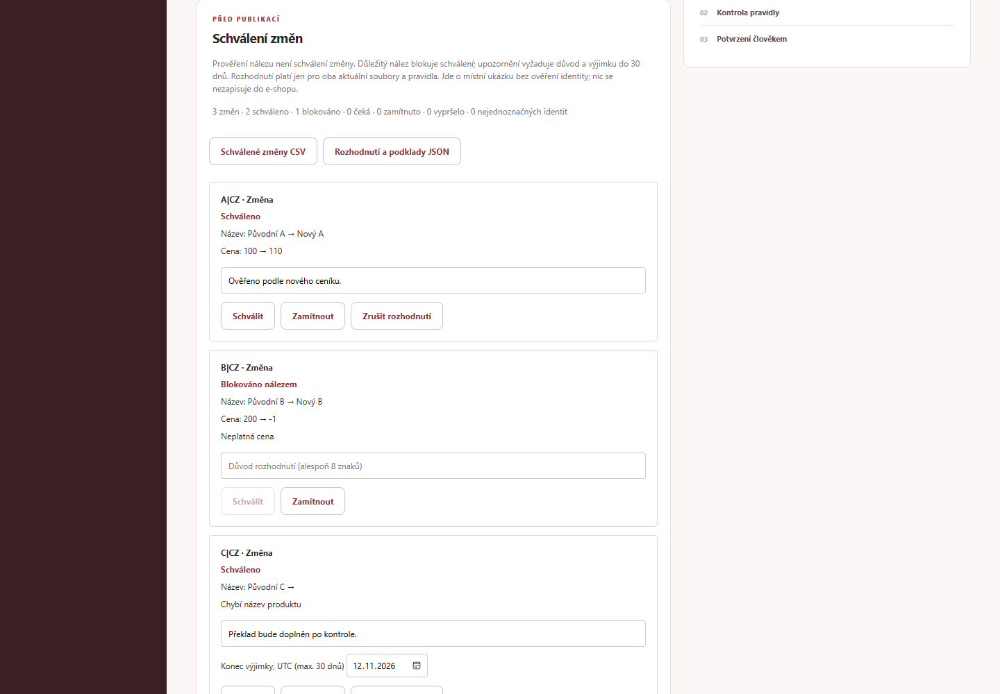

# Shop Ops Kit

**Kontrola produktového katalogu před publikací: zdrojové rozdíly, obchodní pravidla, schvalování a prověřené textové návrhy.**

[Veřejná funkční aplikace](https://omegacatt.github.io/shop-ops-kit/) · [CI](https://github.com/OmegaCatt/shop-ops-kit/actions/workflows/ci.yml) · [Galerie portfolia](https://omegacatt.github.io/datadesk/portfolio/)



## Ukázka za dvě minuty

„Načíst ukázku tří změn“ připraví dva fiktivní exporty: monitor (název a +5 % ceny), dokovací stanici (+900 %) a klávesnici bez názvu. Nic není předem schválené. Monitor po kontrole schvalte s důvodem, stanice zůstane blokovaná, klávesnice vyžaduje opravu nebo posouzenou omezenou výjimku. CSV export obsahuje jen platně schválené změny.

Vlastní data, rozhodnutí a připravené textové návrhy se před nahrazením potvrzují; zrušení je zachová. Report správně rozlišuje připravené a vlastní podklady. Ukázka nic nepublikuje do e-shopu.

## Pracovní postup

1. Načíst aktuální a volitelně předchozí katalog jako CSV nebo verzovaný JSON. Soubory se zpracují výhradně v prohlížeči. Zkontrolovat SKU/trh, měnu, cenu, sklad, název a cestu produktu.
2. Potvrdit obchodní předpoklady: společný sklad mezi trhy, očekávané země CZ/SK/DE a procentní mez změny ceny. Porovnat původní/nové hodnoty. Duplicitní identity se potichu neslučují.
3. Prověřit nálezy. Toto označení **není schválení změny**. Důležitý nález schválení blokuje; upozornění vyžaduje důvod a výjimku do 30 dnů (UTC).
4. Schválit nebo zamítnout konkrétní změnu SKU/trhu s důvodem. Export obsahuje jen platná schválení navázaná na SHA-256 obou vstupů a pravidel. Změna zdroje/pravidel je zruší.
5. Stáhnout schválené změny CSV, JSON rozhodnutí/podkladů nebo standardní report a seznam zjištění. Textová CSV pole jsou chráněná proti vyhodnocení jako vzorec. Nic se nepublikuje do e-shopu.

## CSV a JSON kontrakt

Do 2 MB / 10 000 řádků. Sedm polí: sku, market, title, price, currency, stock, url. CSV má hlavičku a skutečná čísla fyzických řádků; interní/prototypové názvy jako _row, _location nebo __proto__ jsou rezervované a odmítají se. JSON má format shop-ops-catalog, version 1 a products s právě sedmi **textovými** hodnotami na položku, bez dalších objektů. Cenu a sklad ponechává jako původní text pro audit, neplatné obchodní hodnoty neopravuje převodem.

```json
{"format":"shop-ops-catalog","version":1,"products":[{"sku":"A","market":"CZ","title":"Fiktivní monitor","price":"100","currency":"CZK","stock":"2","url":"/cz/a"}]}
```

Zdroj JSON se zobrazuje cestou products[index], nikoli jako předstíraný fyzický řádek. Tlačítko „Aktuální katalog JSON“ poskytne vzor i export normalizovaného katalogu; nepřenáší schválení. Oba formáty používají stejný audit a schvalovací bránu.

## Návrhy produktových textů

Vyberte jednoznačné SKU/trh a krátkou nebo úplnou šablonu. Nástroj ukáže zdrojová fakta a lokaci; přebírá pouze název, SKU, cenu/měnu a sklad. Nevytváří překlad, zdravotní účinky nebo chybějící parametry a nevolá AI. Důležitý nález blokuje přípravu.

Člověk porovná návrh s podkladem a potvrdí jej s důvodem. Exportují se pouze platné prověřené návrhy s otiskem faktů a varianty. Nový katalog, pravidla nebo reset návrhy odstraní. Texty jsou samostatný návrh, nikoli aktualizace katalogu. Převzatý zdrojový název může sám obsahovat tvrzení; šablona nezávisle neověřuje jeho pravdivost.

## Druhý modul: objednávky × zásilky

Připravených 6 objednávek a 7 expedičních událostí ukazuje duplicitní eventId, zásilku bez objednávky, rozdílné SKU, zrušenou/neuhrazenou objednávku a množství. Opakovaný event se započte jednou, problém zůstane dohledatelný podle ID. Modul má **připravená data**, ne import vlastních objednávek nebo skutečné webhooky. Pro skutečnou komunikaci dvou místních služeb viz [FlowBridge](https://github.com/OmegaCatt/flowbridge).

## Technologie a ukládání

JavaScript ES modules, HTML/CSS, vlastní CSV parser, JSON kontrakt, Web Crypto SHA-256 a node:test. Statický Node.js server nebo GitHub Pages; žádné externí API, klíč nebo LLM. Kontroly běží pravidlově v prohlížeči. Místní rozhodnutí a návrhy nepřetrvají reload; uchovejte si report. Export není podepsaný audit a neověřuje identitu schvalovatele. Ceny se kontrolují proti pravidlům, nikoli jako obchodně správná nabídka nebo účetnictví; měny se nepřepočítávají.

## Spuštění a ověření

Node.js 24, běh bez instalace balíčků:

```powershell
node server.mjs
```

[127.0.0.1:4175](http://127.0.0.1:4175). Pro vývoj a prohlížečové testy:

```powershell
pnpm install --frozen-lockfile
pnpm exec playwright install chromium
pnpm test
pnpm check
pnpm qa
pnpm build
```

22 Node testů, původní schvalovací browser sada i nový JSON/textový průchod. Skutečná veřejná URL byla ověřena bez přihlášení, včetně kontroly a exportu návrhu, zneplatnění a mobilu. CI kódu [686b1e4](https://github.com/OmegaCatt/shop-ops-kit/actions/runs/42729974986) prošlo; [QA](docs/QA.md) uchovává podrobnosti a benchmarky. Sestavení pro veřejnou stránku kopíruje jen výslovně povolené statické soubory, žádný server/env/data adresář.

## Zavedení do firmy

Dohodnout, co je autoritativní sklad/ceník a které trhy mají produkt nabízet. Pilotovat na schválených exportech; nevyřešené identity ponechat k ručnímu rozhodnutí. Přidat firemní identity/role, trvalou historii, retenci, zálohy, skutečný schvalovací proces a sandbox konektoru. Teprve schválený a ověřený konektor může zapisovat do konkrétního e-shopu. Aplikace na Shoptetu nestojí a jeho znalost nepředstírá.

## English

A fictional catalog audit and pre-publication workflow. CSV and versioned JSON normalize to the same checks for SKU/market, currency, price, stock, titles and paths. Compare two snapshots, configure business rules, record reviewed findings separately from approvals, and export only valid fingerprint-bound approved changes. Critical findings block approval; warnings need a bounded exception and reason.

Source-only product copy templates require explicit human review; no AI, translation, invented benefits or live shop writes. Current facts, template and text must match before export. Source/rule changes invalidate decisions and drafts. A separate orders/shipment module uses prepared fixtures only. All processing stays in the browser; decisions are local and not authenticated or persistent across reloads.

The one-click walkthrough loads three fictional changes without preapproving anything. It protects custom inputs and prepared drafts with a confirmation, demonstrates a blocked price and exports only actual approvals.

Run node server.mjs (4175) or use the public GitHub Pages app. 22 automated tests and three browser suites cover approval gates, JSON provenance, draft review, invalidation and exports on desktop/mobile. Company adoption needs authoritative source contracts, accounts, durable audit, retention and a tested target connector.
