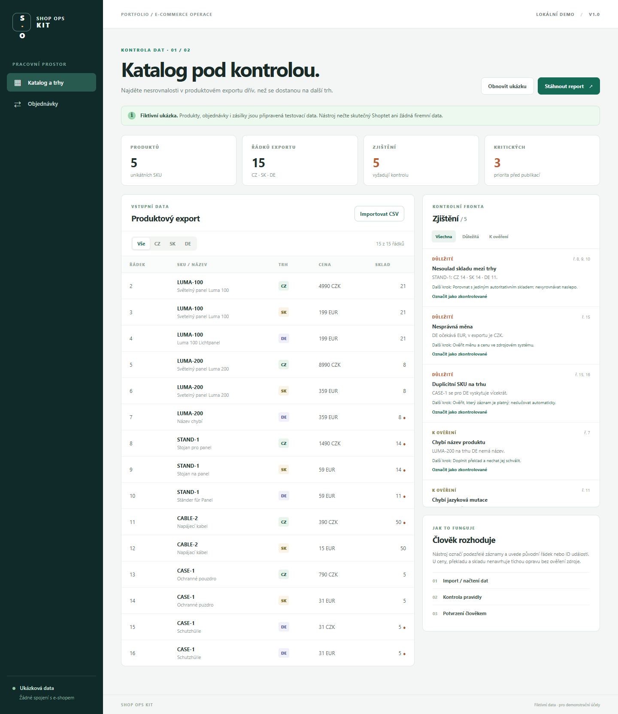

# Shop Ops Kit

**Dvě malé ukázkové aplikace pro provoz e-shopu:** kontrola produktového exportu pro CZ/SK/DE a porovnání objednávek se zásilkami. Vznikly jako portfolio pro roli, která kombinuje e-commerce, data, automatizaci a QA. Všechny dodané produkty a objednávky jsou fiktivní. Projekt není napojený na MITO LIGHT ani jiný skutečný obchod.



## Spuštění

Vyžaduje Node.js 20+; nepotřebuje balíčky ani API klíč.

```bash
npm start
```

Otevřete `http://127.0.0.1:4174`. Testy: `npm test`. Pokud máte Node.js bez příkazu npm, použijte `node server.mjs` a `node --test`.

## 1. Katalog a trhy

- Import CSV (čárka nebo středník, včetně uvozovaných hodnot; max. 2 MB / 10 000 řádků).
- Porovnání předchozího a aktuálního katalogového CSV: přidané, odebrané a změněné SKU podle trhu, včetně změn ceny, skladu, názvu, měny a URL. Duplicitní identity se označí jako nejednoznačné; úplný rozdíl je v JSON reportu.
- Kontrola duplicitního SKU na trhu, názvů, cen, měn, skladu, URL a chybějících jazykových mutací.
- Každé zjištění obsahuje odkaz na původní číslo řádku a doporučený krok k ručnímu ověření.
- Filtrování podle trhu a závažnosti, označení jako zkontrolované a export JSON reportu. Nový CSV export zjištění respektuje aktivní filtr závažnosti a zahrnuje aktuální stav prověření.
- Stránkování katalogu po 100 řádcích a zjištění po 50 záznamech drží rozhraní použitelné i pro větší CSV; export obsahuje všechny výsledky.

Požadované sloupce: `sku;market;title;price;currency;stock;url`. Trhy: CZ (CZK), SK (EUR), DE (EUR). Testovací katalog předpokládá stejný fyzický sklad pro všechny tři trhy; skutečný provoz může mít sklady oddělené, a pravidlo by se pak upravilo.

## 2. Objednávky a zásilky

- Porovnání fiktivních objednávek a expedičních událostí.
- Zpracování opakovaného `eventId` jen jednou (idempotence).
- Zjištění zásilky bez objednávky, nesouladu SKU, expedice zrušené objednávky a chybějícího odeslání zaplacené objednávky.
- Export kontrolního reportu. Tento modul používá připravená data; nemá import skutečných objednávek.
- CSV výstup zjištění pro další práci v tabulce; při exportu se neutralizují vstupy, které by tabulkový procesor mohl vyhodnotit jako vzorec.

Rozklikávací panel v obou pohledech vysvětluje technologie, vstupy a postup kontroly. Na telefonu se ovládání exportu zalomí a širší tabulku lze posunout vodorovně.

## Co uvidíte po spuštění

Výchozí katalog obsahuje 5 produktů na 15 řádcích a 5 zjištění (3 důležitá). Ukázka objednávek obsahuje 6 objednávek a 7 expedičních událostí; jedna událost má opakované ID, proto se započítá jen 6 unikátních událostí. Modul zobrazí 6 zjištění k prověření. Kliknutí na „Označit jako zkontrolované“ mění stav pouze v otevřené stránce; při obnovení se ztratí. Stažený JSON report obsahuje i aktuální označení.

## Rozhodnutí a limity

- Pravidla pouze označují riziko. Neprovádějí automatické změny v cenách, skladech ani překladech.
- Kontrola ceny ověřuje kladnou číselnou hodnotu a měnu trhu; neurčuje, zda je cena obchodně správná ani nepočítá směnné kurzy.
- Veškeré zpracování probíhá lokálně v prohlížeči. Server pouze servíruje statické soubory na `127.0.0.1` a používá omezenou sadu cest a bezpečnostní hlavičky.
- Dalším krokem pro skutečný provoz by byl import anonymizovaného exportu nebo samostatný konektor s přístupovými právy a testovacím prostředím.
- AI byla použita jako vývojový asistent při návrhu, implementaci a kontrole. Zjištění v aplikaci vznikají deterministicky podle popsaných pravidel, ne pomocí LLM.

## Ověření

Sedm automatických testů prošlo. V prohlížeči jsem načetl dva fiktivní katalogy, ověřil souhrn jedné přidané, jedné odebrané a jedné změněné položky a zkontroloval úplný JSON report. Nový průchod ověřil rozklikávací technický přehled, CSV podle filtru a mobilní šířku 390 px; původní kontrola prověřila také stránkování větších exportů.

## English summary

Shop Ops Kit contains two portfolio demos for e-commerce operations: a CZ/SK/DE product feed auditor and an order-versus-shipment reconciler. The catalog tool compares previous and current CSV exports, flagging ambiguous duplicates. It links findings to source rows or event IDs and handles duplicate shipment events idempotently. A filtered, spreadsheet-safe CSV exports findings and review state; JSON retains the full report. An expandable in-app note explains the stack and process. All data is fictional; there is no live shop integration. Node.js 20+ is sufficient, with no dependencies or API keys.
